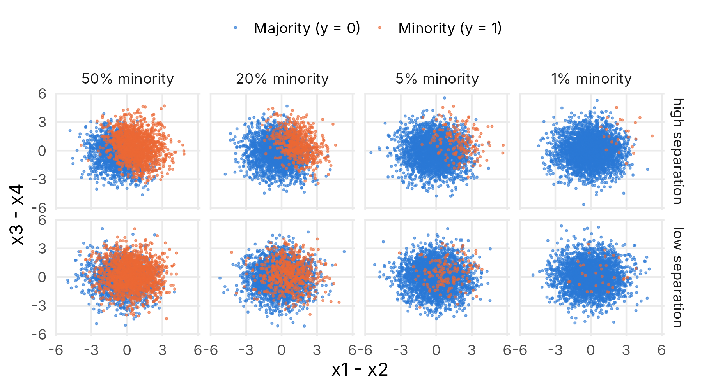
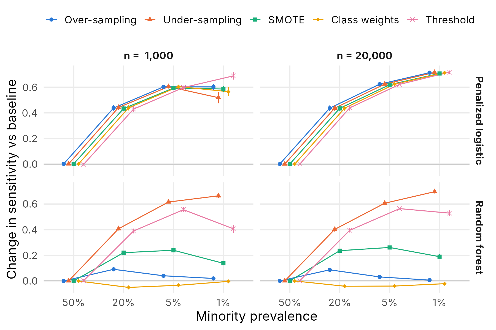
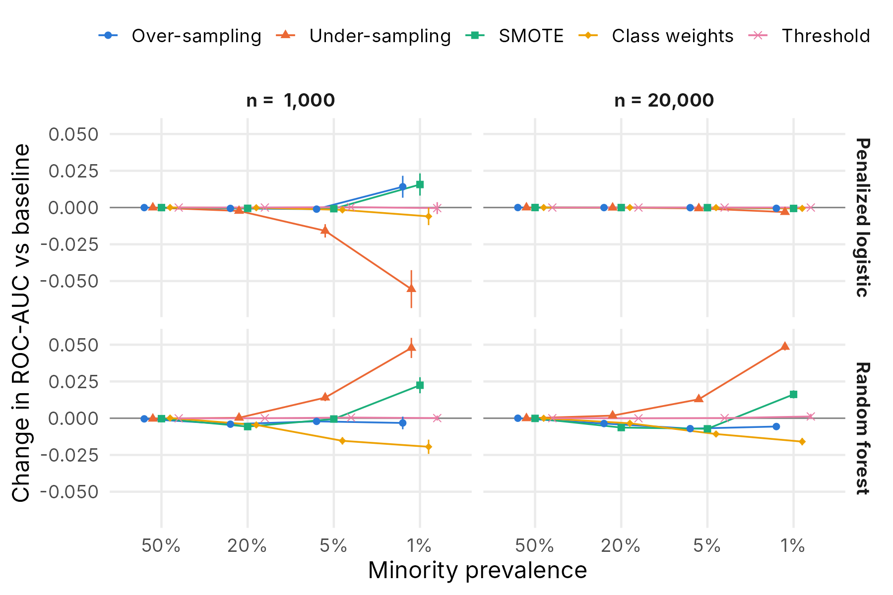
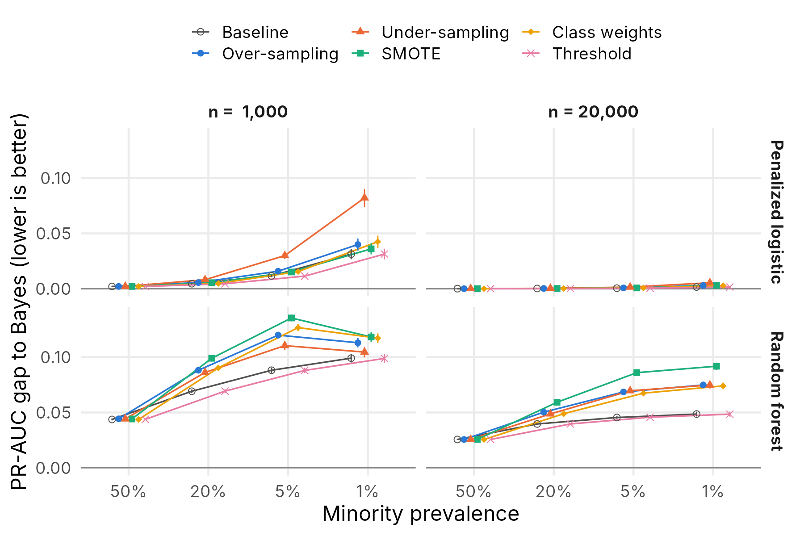
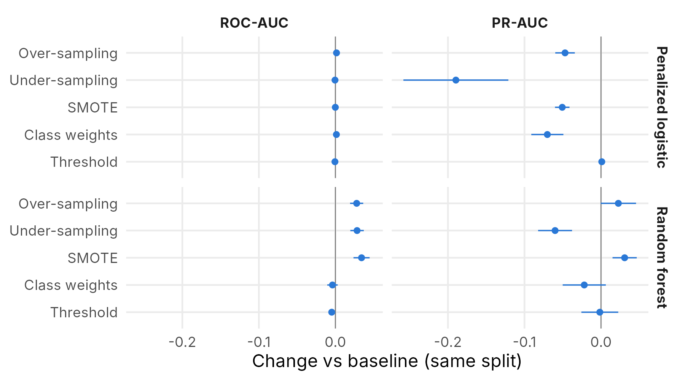
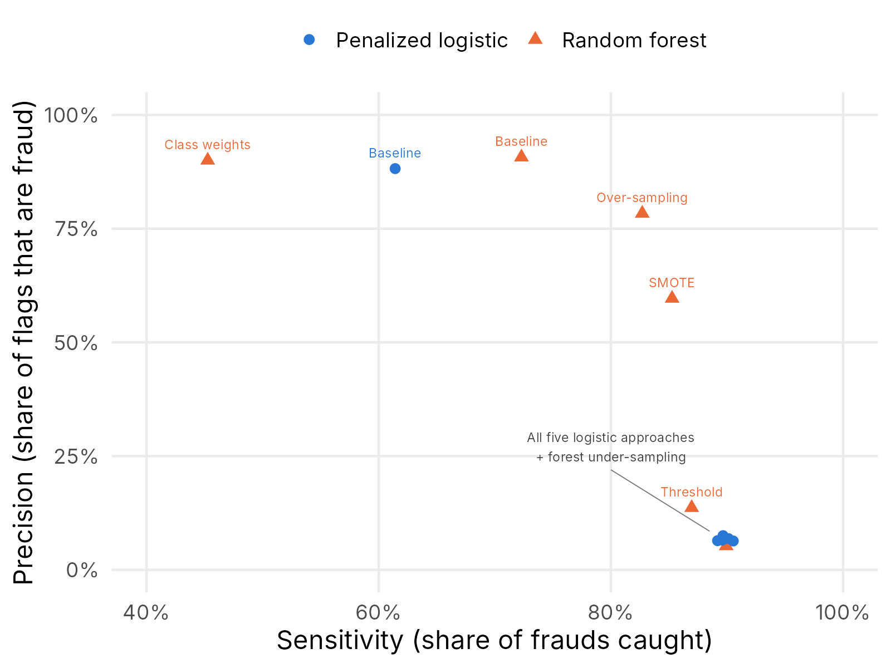
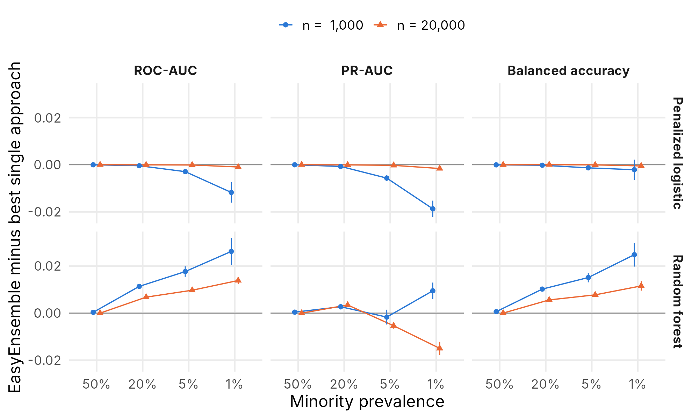
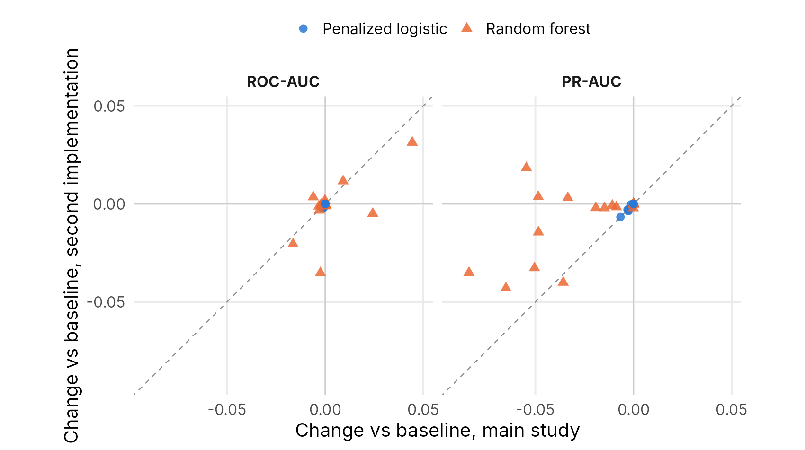

## The problem: 99.8% accurate and useless {.center}

::: {.big-number}
99.83%
:::

::: {.center-text}
accuracy of **"always say not fraud"** on 284,807 real credit card transactions

It catches **0** of the 492 frauds.
:::

::: notes
SPEAKER: John Anyanso.
Open with the handout's example on the real Kaggle data: 0.17% of transactions are fraud,
so a model that never flags anything is 99.83% accurate and completely useless.
Accuracy rewards ignoring the rare class.
:::

## Our question

When positives are rare, people reach for three standard remedies:

:::: {.columns}
::: {.column width="33%"}
### A. Resampling
Over-sample, under-sample, or **SMOTE**: change the training data to 50:50
:::
::: {.column width="33%"}
### B. Class weights
Keep the data; make each fraud **count more** in the fit
:::
::: {.column width="33%"}
### C. Threshold
Keep the model; **lower the 0.5 cutoff**
:::
::::

 

::: {.callout-note appearance="minimal"}
**Do they improve *prediction*, or only improve the *metric*?**
Tested with 2 classifiers (lasso logistic regression, random forest), on simulated data
where we know the truth, then on the real fraud data.
:::

::: notes
SPEAKER: John Anyanso.
Each remedy was owned by one team member: A John Anyanso, B Nidhi Prajapati, C Ambali Wadud.
"Improve prediction" means better ranking of frauds (ROC-AUC, PR-AUC);
"improve the metric" means a higher sensitivity at some cutoff.
:::

## Simulation: we write the truth

:::: {.columns}
::: {.column width="42%"}
::: {.formula}
P(fraud | x) = logistic( β₀ + sep × (x₁ − x₂ + 0.5x₃ − 0.5x₄) )
:::

- **Only β₀ changes** with prevalence: the slopes stay fixed, so "rarer" is separated from "harder"
- 4 prevalences × 2 sample sizes × 2 separations = **16 settings**
- **100 replicates** each, fresh 20,000-row test set every time
- Seed 447; every method sees the **same** data sets
:::
::: {.column width="58%"}

:::
::::

::: notes
SPEAKER: John Anyanso.
Logistic truth because the outcome is yes/no (Lecture 5) and the handout asks for it.
Separation scales the slopes. n = 1,000 at 1% gives about 10 positives (small count);
n = 20,000 at 1% gives 200 (small proportion, larger count).
The Bayes benchmark uses the true probabilities, the best any method could do.
In total: 1,600 data sets × 12 methods = 19,200 model fits.
:::

## Result 1: sensitivity jumps

{fig-align="center" height="540"}

::: {.small-caption}
Change from the baseline on the same data sets, 200 replicates per point, bars ±2 MCSE.
:::

::: notes
SPEAKER: John Anyanso.
Change from the baseline on the same data sets (paired), bars ±2 MCSE.
Every approach except forest class weights raises sensitivity, by up to +0.7.
So by the metric, the remedies "work". Next slide: did prediction improve?
:::

## Result 2: …but the ranking barely moves

{fig-align="center" height="540"}

::: {.small-caption}
Change in ROC-AUC from the baseline on the same data sets, bars ±2 MCSE.
:::

::: notes
SPEAKER: John Anyanso.
Logistic regression: ROC-AUC change is essentially zero for every remedy.
Reason: when the logistic model is correct, rebalancing changes only the intercept,
the same knob we used to create the imbalance, so the ranking cannot change.
Exception: random forest + under-sampling, +0.048 ROC-AUC at 1% (MCSE 0.002), a real gain.
Class weights make the forest worse (randomForest's classwt is weak).
:::

## Result 3: nothing closes the gap to the best possible

{fig-align="center" height="540"}

::: {.small-caption}
Bayes (true-probability) PR-AUC minus method PR-AUC. Lower is better.
:::

::: notes
SPEAKER: Ambali Wadud.
PR-AUC focuses on the rare class; its "random guess" value equals the prevalence.
Gap = Bayes (true probabilities) minus method. No approach gets closer to the best possible
than the baseline; resampling makes the forest's PR-AUC worse.
The threshold uses the same model as the baseline, so its line sits on the baseline's.
:::

## The threshold gets the same gains, for free

| Logistic, 5%, n = 20,000 | Sensitivity | Specificity | ROC-AUC | Mean predicted P(fraud) |
|---|:-:|:-:|:-:|:-:|
| Baseline (cutoff 0.5) | 0.23 | 0.995 | 0.924 | **0.05** ✓ |
| Over-sampling | 0.88 | 0.82 | 0.924 | **0.27** ✗ |
| Threshold (cutoff 0.046) | **0.88** | 0.81 | 0.924 | **0.05** ✓ |

 

- Resampling and weights make the model **believe fraud is common**: the probabilities are wrong
- The threshold **leaves the model and its probabilities intact** and only changes when we act
- The cutoff is chosen on out-of-fold / out-of-bag training predictions, **never the test set**

::: notes
SPEAKER: Ambali Wadud.
One replicate shown; the full simulation confirms the pattern.
A cutoff t corresponds to a cost ratio (1 − t)/t (Lecture 6), so the threshold is the
honest way to say "a missed fraud costs more than a false alarm".
:::

## Real data: 284,807 transactions, 10 splits

{fig-align="center" height="540"}

::: {.small-caption}
Real data: mean paired change over 10 stratified 70/30 splits, bars ±2 SE.
:::

::: notes
SPEAKER: Nidhi Prajapati.
Stratified 70/30 splits; Time and Amount standardized with training statistics.
Logistic: ranking unchanged, PR-AUC drops for every resampling remedy (−0.05 to −0.19).
Forest: SMOTE and over-sampling raise both ROC-AUC (to 0.983) and PR-AUC (+0.03).
Two data issues we solved: glmnet's default lambda path does not converge on this data
(we used a finer path); random forests draw 20,000 rows per tree.
:::

## Catching more fraud costs precision

{fig-align="center" height="540"}

::: {.small-caption}
Real data, mean over 10 splits, each method at its own cutoff.
:::

::: notes
SPEAKER: Nidhi Prajapati.
Pushing sensitivity to about 90% drops precision to about 6% for every logistic remedy:
about 15 false alarms for every real fraud.
Forest + SMOTE is the best balance: 85% caught at 60% precision.
:::

## Reconciling simulation and real data

| | Simulation (1%, n = 20,000) | Real data (0.17%) |
|---|:-:|:-:|
| Logistic: ranking improves? | No (≈ 0) | No (≈ 0) |
| Logistic: PR-AUC | ≈ 0 | **−0.05 to −0.19** |
| Forest + SMOTE: PR-AUC | −0.084 | **+0.031** |
| Forest + class weights | worse | worse |

**What the simulation left out**

1. **A wrong model.** Our truth *was* logistic, so rebalancing only moved the intercept.
   Real frauds are not exactly logistic, so rebalancing also bends the slopes (Prentice & Pyke, 1979).
2. **Clustered frauds.** Real frauds likely sit in small clusters that a forest can learn once it sees enough of them.
3. **Our own set-up.** With 20,000 rows per tree, a baseline tree sees only about **34** frauds; after SMOTE, about **10,000**.

::: notes
SPEAKER: Nidhi Prajapati.
Point 3 is about our design, and we say so honestly: on real data, resampling also fixes
a "too few frauds per tree" problem the simulated forests did not have.
:::

## STAT 847: EasyEnsemble

:::: {.columns}
::: {.column width="34%"}
**Idea:** under-sample 10 times with **different** majority rows, fit a model to each, **average** the probabilities

- Each model trains on balanced data; together they see most of the data
- Forest members get 20 trees each: **same 200 trees** as one forest
- Compared, replicate by replicate, with the **best** single approach in each setting
:::
::: {.column width="66%"}

:::
::::

::: notes
SPEAKER: Ambali Wadud.
Forest: the ensemble beats the best single approach on ROC-AUC and balanced accuracy in
11 of 12 imbalanced settings, and the gain grows as imbalance worsens (up to +0.03 at 1%).
Logistic: never better; worse at 1%, n = 1,000, where each member sees only about 20 rows.
PR-AUC: mixed. Real data: ties on ROC-AUC, loses 0.08 PR-AUC to SMOTE / threshold.
Averaging helps an unstable learner (the forest), not a stable, correct one (logistic).
:::

## Robustness: an independent second implementation

{fig-align="center" height="520"}

::: {.small-caption}
Each dot: one remedy × prevalence × classifier at n = 20,000. Dashed line = the two studies agree exactly.
:::

::: notes
SPEAKER: Ambali Wadud (who wrote the second implementation).
Different packages (ranger, themis), partial rebalancing, nested CV, F1/F2 thresholds,
a different ensemble. Reran from source: results at 20% and 50% reproduce to every digit.
Same direction as ours in 91% of ROC-AUC and 78% of PR-AUC comparisons.
Read the plot: every logistic dot sits on (0, 0), both studies say "no change".
Forest dots mostly share our quadrant (both lose PR-AUC), but the second study's drops are smaller because it rebalances only partway (25% / 4:1), not to 50:50.
Only 3 replicates, so it is a check on our conclusions, not separate findings.
:::

## Conclusions

1. **The remedies change the operating point, not the ranking**, for logistic regression.
   Sensitivity rises to about 90%, but no remedy improves ROC-AUC or PR-AUC.
2. **Forests are different:** under-sampling (and, on real data, SMOTE) can improve the ranking when fraud is very rare.
3. **Accuracy is the wrong target.** Judge the ranking by **PR-AUC**, then pick the cutoff from the **real costs** of a missed fraud vs a false alarm.
4. **Prefer the threshold** for logistic models: the same sensitivity, honest probabilities, no retraining.
5. **EasyEnsemble** helps forests (up to +0.03 at 1%), not logistic regression, and not PR-AUC.

::: notes
SPEAKER: all; each person states the conclusion from their part.
Answer to the handout: "Do the standard remedies improve prediction, or only the metric?"
For a correctly specified logistic model: only the metric. For flexible models on very rare
classes: sometimes prediction too.
:::

## Thank you {.center}

::: {.center-text}
**Questions?**

 

Code, data and results: [github.com/Anyanso/stat447-team2-imbalance](https://github.com/Anyanso/stat447-team2-imbalance)

Seed 447 · R · Quarto · 1,600 simulated data sets · 10 real splits
:::
